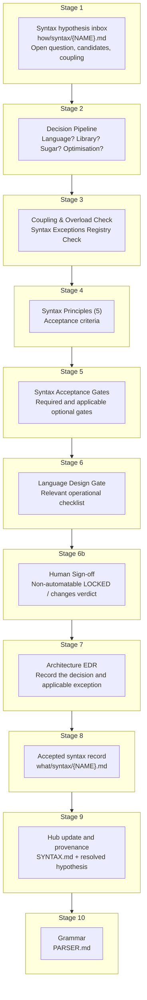
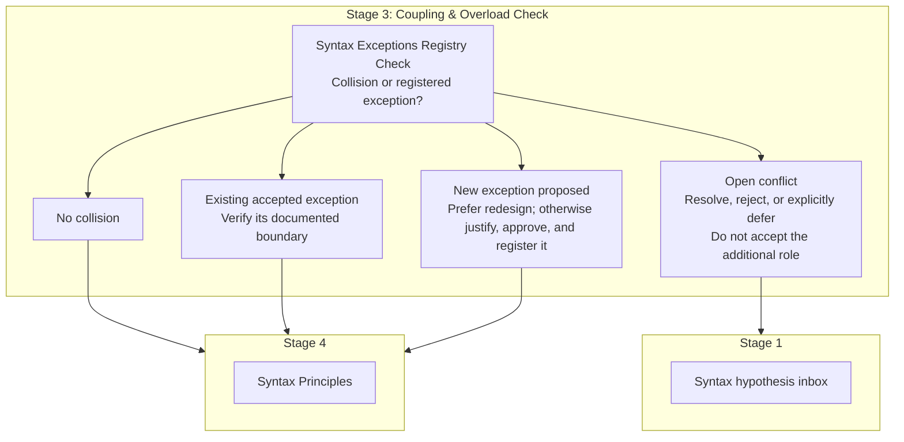
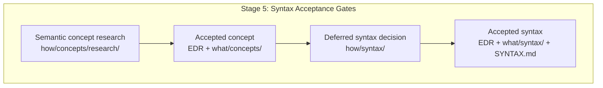

# Syntax Pipeline

> The acceptance pipeline for **syntax decisions** — the syntax-lens
> counterpart to [`CONCEPT_PIPELINE.md`](CONCEPT_PIPELINE.md). It governs
> how an open syntax hypothesis in `how/syntax/` becomes accepted syntax in
> `what/syntax/` and the `what/SYNTAX.md` hub.
>
> **Established by:** [EDR-087](decision_records/process/EDR-087-syntax-acceptance-process.md)
> (2026-08-15).
> **See also:** [`how/syntax/README.md`](syntax/README.md) (hypothesis inbox + decision queue),
> [`DECISION_PIPELINE.md`](process/DECISION_PIPELINE.md) (10-question pre-filter),
> [`DECISION_VALIDATION.md`](gates/DECISION_VALIDATION.md) (§ Gate Selection — "Syntax change" row),
> [`_language-design.md`](gates/_language-design.md) (operational checklist),
> [`ROADMAP.md`](../when/ROADMAP.md) § Phase 5.

---

## Principle

**Syntax is derived from semantics, not the reverse.** A syntax decision
cannot add semantics — it only chooses the surface form of an already
accepted semantic. Any proposal that would change semantics is not a syntax
decision; it routes back through the semantic concept pipeline
([`CONCEPT_PIPELINE.md`](CONCEPT_PIPELINE.md)).

This pipeline **reuses the existing gate machinery** — it does not invent a
parallel gate system. `DECISION_VALIDATION.md` § Gate Selection already
defines a "Syntax change" row; the five Syntax Principles in `what/SYNTAX.md`
are the acceptance criteria.

---

## Pipeline Overview

### Stage 3 — Registry outcomes

**Unified Phase 5 input flow:**

---

## Stages

### Stage 1 — Syntax Hypothesis Inbox

**Location:** [`how/syntax/`](syntax/)
**Documents:** [`how/syntax/README.md`](syntax/README.md) (index + decision queue)

Every open syntax question is registered as one hypothesis file. A
hypothesis is created when an accepted concept defers its syntax to
Phase 5 (for example, `EDR-027`/`EDR-074` → type annotation) or when a
review surfaces a syntax-only problem (for example, the `->` overload in
`FUNCTION_RETURNING_FUNCTION.md`). No gate is required to add a hypothesis;
it is input material.

### Stage 2 — Decision Pipeline (pre-filter)

**Documents:** [`process/DECISION_PIPELINE.md`](process/DECISION_PIPELINE.md)

The standard 10-question pre-filter applies. Exit paths:
- **Not a syntax decision** (adds semantics) → route back to the concept pipeline.
- **Syntactic sugar** → mark accordingly; proceed.
- **Optimisation** → move to `what/OPTIMIZATION_MODEL.md`.
- **Library problem** → StdLib, not language syntax.
- Otherwise → continue.

The result of a pipeline run is recorded as a **«Decision Pipeline Run»**
section inside the hypothesis document (not as an EDR — the EDR records the
eventual *decision*, the run is provenance).

### Stage 3 — Coupling & Overload Check + Syntax Exceptions Registry Check *(syntax-specific)*

This is the syntax-specific control, not a new validation gate. Every syntax
decision must pass a **symbol/keyword collision sweep across all accepted
concepts** and consult the [Syntax Exceptions
Registry](SYNTAX_EXCEPTIONS.md):

- The proposed symbol/keyword must not already carry a different meaning in
  another concept (**one symbol → one meaning**).
- Precedents already resolved this way: `EDR-083` banned `:` from ranges;
  `EDR-086` moved generics bounds off `:` and off `[ ]`.
- Cross-hypothesis coupling must be explicit: `,`, `:`, `<>`, `->`, and the
  signature tail (`require` / `using` / `where` / `-> Return`) are known
  contention points (see `FUNCTION_RETURN_SYNTAX.md`, `BOUNDS_IN_ANGLE_BRACKETS.md`).

The review records exactly one outcome:

1. **No collision** — the proposed element has no conflicting responsibility.
2. **Existing accepted exception applies** — the proposal stays within the
   registry entry's documented boundary.
3. **Open conflict** — the proposal cannot be accepted until the collision is
   resolved, rejected, or explicitly deferred.
4. **New exception proposed** — redesign is preferred. If redesign does not
   preserve the required semantics, the normal acceptance path, including
   human sign-off, must justify the exception and create its registry entry
   before acceptance.

An unregistered exception is a design defect, not a context-derived
allowance. The syntax-hypothesis queue records decisions in progress; the
registry records exceptions and collision history.

### Stage 4 — Syntax Principles

The five accepted criteria (ratified by EDR-087, defined in `what/SYNTAX.md`):

1. **One concept → one syntax** — each concept has exactly one canonical form.
2. **One symbol → one meaning** — context-independent.
3. **No significant whitespace** — indentation is cosmetic.
4. **Named before symbolic** — named form exists when ambiguity risk outweighs brevity.
5. **Syntax derived from semantics** — never the reverse.

### Stage 5 — Syntax Acceptance Gates

Per `DECISION_VALIDATION.md` § Gate Selection — the **"Syntax change"** row:

| Required | Optional |
|----------|----------|
| `LOGICAL_CONSISTENCY_GATE` | `USER_VALUE_GATE` (if purely syntactic sugar) |
| `CONCEPTUAL_SIMPLICITY_GATE` | `IMPLEMENTATION_INDEPENDENCE_GATE` |
| `ARCHITECTURAL_INTEGRITY_GATE` | `LONG_TERM_MAINTAINABILITY_GATE` |
| `LLM_GENERABILITY_GATE` | |

No new gate system is introduced; these gates are the existing ones applied
to a syntax-only proposal.

### Stage 6 — Language Design Gate (relevant criteria)

From [`gates/_language-design.md`](gates/_language-design.md), the
syntax-relevant items: **Named equivalence** (if symbolic, the named form
exists), **All canonical forms** documented, **Explicitness** (semantic
changes syntactically visible), **Orthogonality** (no context-dependent
behavior), **LLM generability** (no ambiguities an LLM can misparse).

### Stage 6b — Human Sign-off

The solo author explicitly confirms the chosen surface form before any
EDR is written. This is the syntax-pipeline counterpart of the Concept
Design Review's Convergence Check (Step 7) — a **non-automatable** gate:
agents/GSD flows must NOT self-certify it. Record:

`Reviewed-by: <author> · Date: YYYY-MM-DD · Verdict: [LOCKED / changes]`

**Rule:** An EDR may not be filed until this sign-off is populated. The
EDR is a **record** of a stable, human-approved syntax decision, not a
draft for iteration. The hypothesis doc's «Decision Pipeline Run» and
the gate verdicts remain the EDR's validation trail.

### Stage 7 — EDR (Architecture category)

Each accepted syntax decision gets an Architecture-category EDR recording
context, decision, consequences, and alternatives — the same record type as
a semantic concept. The hypothesis doc's «Decision Pipeline Run» and the
gate verdicts become the EDR's validation trail. When an exception applies,
the EDR must link to its registry entry and the entry must link back.

### Stage 8 — Accepted Syntax Record

The accepted syntax is written to `what/syntax/{NAME}.md` (What layer) —
the canonical reference for that construct's surface form. This mirrors
`how/concepts/research/` → `what/concepts/`. When an exception applies, the
record links to its registry entry; the registry remains control metadata,
not a replacement for this canonical record.

### Stage 9 — Hub Update + Provenance

- `what/SYNTAX.md` (the hub) gains a pointer to the new record and any
  cross-cutting syntax rules that belong at the top level.
- The hypothesis doc in `how/syntax/` is marked **"Resolved — see
  `SYNTAX.md` § …"**, following the `RANGE_STEP.md` precedent
  (*"✅ ACCEPTED via EDR-083 … This document is the reasoning trail; the
  accepted specification lives in the concept."*). Research remains
  provenance, not dead weight.

### Stage 10 — Grammar

`how/architecture/PARSER.md` is updated with the concrete grammar for the
new syntax.

---

## Relationship to Phase 5 (ROADMAP)

Phase 5 (Syntax Design) runs in two passes, in order:

1. **Deferred-items pass:** inventory and resolve all open syntax hypotheses
   in `how/syntax/` (the Decision Queue). No accepted concept's syntax is
   designed without first checking whether its deferred syntax question
   already has a hypothesis.
2. **Per-concept pass:** produce syntax for each accepted Language concept
   (ROADMAP Phase 5 step 2), folding results into `what/syntax/` + the hub.

Exit criteria: *"Every language concept has defined syntax"* AND *"All open
syntax hypotheses in `how/syntax/` resolved and folded into `SYNTAX.md`"*
AND *"Every open registry conflict is resolved, rejected, or explicitly
deferred, and every accepted exception has complete reciprocal provenance."*
