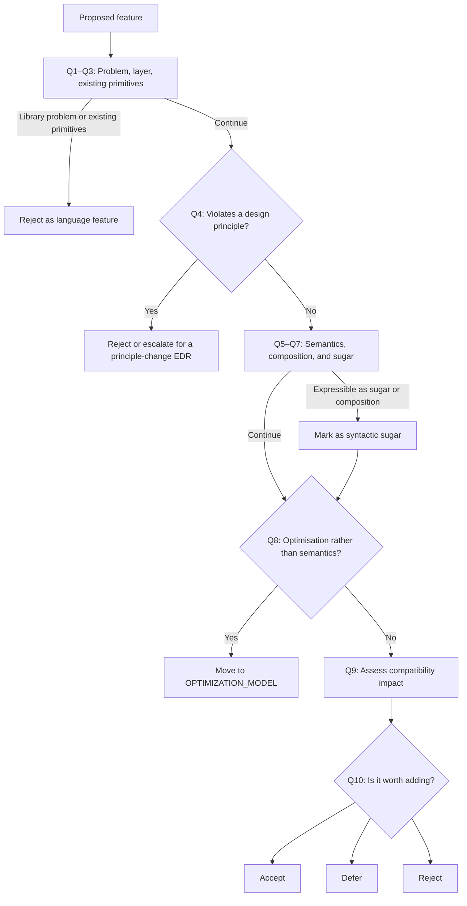

# Decision Pipeline

> This document defines the 10-question pipeline that every proposed
> language feature must pass before detailed design begins.
>
> **Status:** Finalized during Phase 1.1 (Foundation Completion).
> Per-concept pipeline application results are recorded in
> [`DECISION_LOG.md`](../gates/DECISION_LOG.md) — one entry per
> concept with full Q&A, classification, and primitive decomposition.
> See [`EDR-079`](../decision_records/architecture/EDR-079-aggregating-p4.md)
> for the Phase 4 aggregating acceptance record.
> **See also:** [`ROADMAP.md`](../../when/ROADMAP.md) § Phase 4,
> [`DECISION_PROCESS.md`](DECISION_PROCESS.md),
> [`Concept Design Review`](../../how/concept-design-review.md),
> [`DECISION_LOG.md`](../gates/DECISION_LOG.md)

---

## The Pipeline

For each proposed feature, run through these 10 questions in order:

```
 1. What problem are we solving?
 2. Is this a language problem or a library problem?
 3. Can it be solved with existing primitives?
 4. Does it violate any Design Principle?
 5. Does it add new semantics (vs. syntactic sugar)?
 6. Can it be expressed through composition?
 7. Can it be syntactic sugar over existing primitives?
 8. Is this an optimisation, not semantics?
 9. Does it affect backward compatibility?
10. Is it worth adding at all?
```

For proposals that continue to detailed design, use
[Nyquist Validation](../gates/methods/NYQUIST_VALIDATION_METHOD.md)
while preparing gate evidence to check whether significant semantic
invariant violations would be detectable. This supplemental method
does not change the ten-question pre-filter.

## Decision Flow


